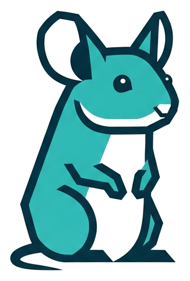

<p align="center">
  
</p>

<h1 align="center">kxn</h1>

<p align="center"><strong>Find what's misconfigured or vulnerable in your servers, databases, Kubernetes, cloud and websites — with one command.</strong></p>

<p align="center">One Rust binary. No agent to install. 1000+ rules (CIS, OWASP, CVEs). Open source, MIT.</p>

<p align="center">
  <a href="https://github.com/kexa-io/kxn/releases/latest"></a>
  <a href="LICENSE"></a>
  <a href="https://github.com/kexa-io/kxn/releases"></a>
  <a href="https://hub.docker.com/r/kexa/kxn"></a>
  <a href="https://github.com/kexa-io/homebrew-tap"></a>
</p>

<p align="center">
  <a href="docs/providers.md"></a>
  <a href="docs/providers.md"></a>
  <a href="docs/providers.md"></a>
  <a href="docs/providers.md"></a>
  <a href="docs/providers.md"></a>
  <a href="docs/providers.md"></a>
  <a href="docs/providers.md"></a>
  <a href="docs/providers.md"></a>
  <a href="docs/providers.md"></a>
  <a href="docs/providers.md"></a>
  <a href="docs/providers.md"></a>
  <br>
  <a href="docs/providers.md"></a>
  <a href="docs/providers.md"></a>
  <a href="docs/providers.md"></a>
  <a href="docs/providers.md"></a>
  <a href="docs/providers.md"></a>
  <a href="docs/providers.md"></a>
  <a href="docs/providers.md"></a>
  <a href="docs/providers.md"></a>
  <a href="docs/providers.md"></a>
  <a href="docs/providers.md"></a>
  <a href="docs/providers.md"></a>
  <a href="docs/providers.md"></a>
</p>

<p align="center">
  <a href="docs/getting-started.md">Getting started</a> ·
  <a href="docs/quickstart-postgres-grafana.md">Dashboards</a> ·
  <a href="docs/providers.md">Providers</a> ·
  <a href="docs/rules.md">Rules</a> ·
  <a href="docs/reference.md">Reference</a>
</p>

## Try it

```bash
curl -fsSL https://raw.githubusercontent.com/kexa-io/kxn/main/install.sh | sh
kxn https://your-site.com
```

The first command installs the `kxn` binary on Linux or macOS. The second downloads the community rules, checks TLS, the certificate and
security headers, and lists each failed rule with its severity. kxn exits with
code 1 when a rule fails, so it drops straight into CI.

## Other ways to install

| | |
|---|---|
| Homebrew (macOS, Linux) | `brew install kexa-io/tap/kxn` |
| Cargo (from source, needs `protoc`) | `cargo install --git https://github.com/kexa-io/kxn kxn-cli` |
| Docker | `docker run --rm kexa/kxn:v0.58.0 <target>` |
| Development build (latest pre-release) | `curl -fsSL https://raw.githubusercontent.com/kexa-io/kxn/main/install.sh \| KXN_VERSION=dev sh` |
| Windows, or any binary | Download from the [releases page](https://github.com/kexa-io/kxn/releases) (x86_64 and arm64) |

Every release archive and Docker image is published with a signed build
provenance attestation, so you can check it was built by this repository's CI:

```bash
gh attestation verify kxn-x86_64-unknown-linux-gnu.tar.gz --repo kexa-io/kxn
gh attestation verify oci://docker.io/kexa/kxn:v0.58.0 --repo kexa-io/kxn
```

## What it checks

Give kxn a target; it loads every rule pack for that kind of target.

| Target | Command | What you get |
|---|---|---|
| Linux server | `kxn ssh://root@10.0.0.1` | CIS hardening, SSH config, users, services, firewall |
| PostgreSQL / MySQL / MongoDB | `kxn postgresql://user:pass@db:5432` | CIS benchmark, roles, settings, replication |
| Kubernetes | `kxn k8s://my-context` (any context of your kubeconfig; `k8s://in-cluster` from a pod) | CIS benchmark, RBAC, privileged pods, resources |
| AWS / Azure / GCP | `kxn aws://eu-west-1` (uses your cloud credentials) | CIS benchmarks (IAM, storage, network, logging) |
| Microsoft 365 | `kxn m365://` (a read-only app: `AZURE_TENANT_ID`, `AZURE_CLIENT_ID`, `AZURE_CLIENT_SECRET`) | CIS Microsoft 365 v7.0: Entra ID, Conditional Access, Exchange, Defender for Office 365, SharePoint, Teams |
| Website / API | `kxn https://example.com` | TLS, certificate, security headers |
| Windows server or PC | `kxn ssh://scanner@winhost` (built-in OpenSSH: [enable it](scripts/windows/enable-ssh.ps1); a standard account is enough) | Build and update level, cumulative update age, installed software |
| Router, switch, firewall | `kxn ssh://audit@10.0.0.254` (a read-only account is enough) | OS, version, model of Cisco, Juniper, Arista, Nokia, MikroTik, Fortinet and Palo Alto devices, detected on its own |
| Package CVEs | `kxn cve-update`, then `kxn ssh://root@host` | Installed packages vs NVD, CISA KEV, EPSS and distribution trackers |
| GitLab | `kxn gitlab://gitlab.example.com` (uses `GITLAB_TOKEN`, scope `read_api`) | Version, sign-up, 2FA for every user, token lifetime |
| GitHub organization | `kxn github://my-org` (uses `GITHUB_TOKEN` or your `gh` login) | 2FA, branch protection, Dependabot, secret scanning, Actions |
| Docker, Forgejo, Google Workspace | `kxn docker://`, `kxn forgejo://git.example.com/owner/repo`, `kxn googleworkspace://example.com` | Container, CI and identity checks |
| 3000+ Terraform providers | `kxn gather -p hashicorp/<name> -t <data source>` | Raw resources as JSON, to check with rules |

### Cloud and SaaS benchmarks, one command each

`kxn rules pull` once, then one command per platform. Each runs every pack
written for that provider; add `--rules` with one pack to run a single
benchmark (pulled packs live in `~/.cache/kxn/rules/<provider>/`),
`--compliance` for the per-framework report, `-o json`, `-o csv` or `-o html`
for a report.

| Platform | Command | Benchmarks run | Credentials (read-only) |
|---|---|---|---|
| Google Cloud | `kxn gcp://my-project` (`gcp://` for every project you can see) | CIS GCP v3.0.0, GKE, best practices, key and secret rotation | `gcloud auth application-default login`, or a service account (`GOOGLE_APPLICATION_CREDENTIALS`) with Viewer, Security Reviewer and Cloud Asset Viewer |
| Microsoft Azure | `kxn azure://<subscription-id>` | CIS Azure v6.0.0, best practices, Key Vault rotation | `az login`, or a service principal (`AZURE_TENANT_ID` / `AZURE_CLIENT_ID` / `AZURE_CLIENT_SECRET`) with Reader and Security Reader |
| Microsoft 365 | `kxn m365://` | CIS Microsoft 365 v7.0.0, CISA SCuBA (ScubaGear), Intune devices | An app registration: Graph read permissions, `Exchange.ManageAsApp`, Global Reader ([setup](docs/providers.md#m365)) — `AZURE_TENANT_ID` / `AZURE_CLIENT_ID` / `AZURE_CLIENT_SECRET` |
| Google Workspace | `kxn googleworkspace://example.com` | CIS Google Workspace v1.4.0, CISA SCuBA (ScubaGoggles), Workspace audit | A super admin through an *Internal* OAuth client, or a service account with domain-wide delegation ([setup](docs/google-workspace.md)) |
| AWS | `kxn aws://eu-west-1` | CIS AWS, IAM, secrets rotation | `AWS_ACCESS_KEY_ID` / `AWS_SECRET_ACCESS_KEY`, or the AWS CLI's login (e.g. the `SecurityAudit` policy) |

```bash
kxn rules pull
kxn m365:// --rules ~/.cache/kxn/rules/m365/scuba.toml --compliance   # one benchmark, by framework
kxn gcp:// -o html > gcp.html   # every project you can see, as a report
```

Scans only read. Fixes run only when you ask for them: `kxn remediate`, `kxn watch --remediate`, or the `kxn_remediate` tool of the MCP server.

## Keep watching

List your targets in `./kxn.toml` ([example](kxn.toml.example)), download the
rules once, then run kxn as a daemon:

```bash
kxn rules pull
kxn watch --metrics-port 9090
```

It rescans on an interval and can:

- **alert** — Slack, Teams, Discord, email, Jira, PagerDuty and more ([alerting](docs/alerting-and-saving.md))
- **store** results — PostgreSQL, Loki, Elasticsearch, S3, Kafka… with ready-made Grafana dashboards ([5-minute setup](docs/quickstart-postgres-grafana.md))
- **expose** Prometheus metrics ([metrics](docs/metrics.md))
- **collect logs** from servers and Kubernetes pods (`kxn logs`)

Look at a target quickly — objects in JSON, TOML, TOON or a table, and live metrics:

```bash
kxn get k8s://prod/monitoring pods -o table      # any object of any target: kxn get <uri> lists the types
kxn get gcp://my-project cloud_run_services -o table  # also cloud_sql_instances, secrets (metadata), pubsub_topics…
kxn get aws://eu-west-1 AWS::Lambda::Function         # any CloudFormation type; azure:// takes any ARM type
kxn top k8s://prod                               # node and pod CPU / memory
kxn top postgresql://user:pass@db:5432           # database statistics (also mysql, mongodb, ssh)
kxn top gcp://my-project                         # bucket sizes, VM and Cloud SQL CPU (also aws://, azure://)
kxn gcp://                                       # every GCP project you can see (also kxn get/top gcp://)
kxn top https://example.com                      # response time, status, days left on the certificate
kxn top gcp:// -o jsonl                         # json, jsonl, toml, toon or table, for get and top
```

Read a pod's logs, like `kubectl logs` but with level filters:

```bash
kxn logs k8s://prod/monitoring/api               # last 100 lines of pods named api*
kxn logs k8s://prod/monitoring --level error -f  # every pod of the namespace, errors only, live
```

On Kubernetes, the [`kxn-stack`](deploy/helm/kxn-stack) Helm chart installs kxn, PostgreSQL and Grafana with the dashboards, and scans the cluster.

## Use it from AI agents

kxn is an MCP server. Register it with every AI agent installed on your machine:

```bash
kxn init --mcp-only
```

Your agent can then scan targets, explain results and propose fixes. `kxn init`
knows 21 agents: Claude Code, Claude Desktop, GitHub Copilot, VS Code, Cursor,
Gemini CLI, Codex, Mistral Vibe, Factory Droid, Trae, OpenCode, OpenClaw, Pi,
Oh My Pi, Hermes, Windsurf (Devin Desktop), Cline, Roo Code, Kilo Code, Google
Antigravity and Kimi. See [agent integration](docs/agent-integration.md) for
the file each one uses.

## FAQ

<details>
<summary><b>Do I need to install anything on my servers?</b></summary>

No. kxn uses what is already there: SSH (key file or password) for servers, a
database connection, the Kubernetes API (your kubeconfig, or a pod's
ServiceAccount) and the cloud providers' APIs.

</details>

<details>
<summary><b>Does kxn send my data anywhere?</b></summary>

No telemetry. kxn talks to the targets you scan and to GitHub: rules, and once
a day a check for a newer release (`KXN_NO_UPDATE_CHECK=1` turns it off; it is
off in CI). CVE feeds and Terraform providers are fetched only when you use them.
Results stay on your machine unless you send them to an alert channel, a
storage backend or an AI agent.

</details>

<details>
<summary><b>Can it break something?</b></summary>

Scans are read-only. Changes happen only when you ask for a fix, on the
violations you pick.

</details>

<details>
<summary><b>Can I write my own rules?</b></summary>

Yes, in TOML: a resource type, a property, a condition. See [rules](docs/rules.md).

</details>

<details>
<summary><b>How is it different from Trivy or Prowler?</b></summary>

Trivy focuses on images, code and clusters, Prowler on cloud accounts. kxn
also checks live servers over SSH, databases and websites from the same
binary, and keeps watching them.

</details>

<details>
<summary><b>What does it cost?</b></summary>

Nothing. kxn is open source under the [MIT License](LICENSE).

</details>

## Documentation

| | |
|---|---|
| [Getting started](docs/getting-started.md) | Install, first scans, rules |
| [Dashboards in 5 minutes](docs/quickstart-postgres-grafana.md) | kxn → PostgreSQL → Grafana, Kubernetes logs, Prometheus |
| [Providers](docs/providers.md) | Every target type, its options and credentials |
| [Rules](docs/rules.md) | Rule packs and writing your own |
| [Configuration](docs/configuration.md) | `kxn.toml`, targets, secrets |
| [Alerting & storage](docs/alerting-and-saving.md) | Alert channels and storage backends |
| [CVE detection](docs/cve-detection.md) | Package vulnerabilities |
| [Reference](docs/reference.md) | Every command and option |
| [Architecture](docs/architecture.md) | How kxn is built |

## Contributing

Issues and pull requests are welcome. Build with `cargo build` (needs `protoc`),
test with `cargo test`.

## License

[MIT](LICENSE). kxn reports known misconfigurations and vulnerabilities; it does
not replace a security audit.
