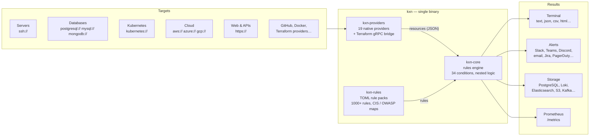
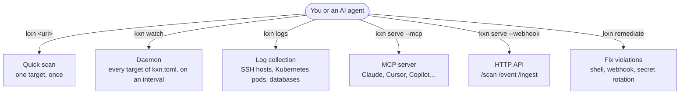

# Architecture

kxn is one Rust binary built from six crates. A scan always follows the same
path: a **provider** gathers resources from a target, the **rules engine**
evaluates them against TOML rule packs, and the results go to the terminal,
to alert channels and to storage backends.



## How kxn runs



## Crates

| Crate | Role |
|---|---|
| `kxn-cli` | The `kxn` binary: commands, alerts, storage backends, Prometheus endpoint |
| `kxn-core` | Rules engine: conditions, operators, evaluation |
| `kxn-rules` | Rule pack parser, `kxn.toml` configuration, secret references |
| `kxn-providers` | Native providers and the Terraform provider bridge |
| `kxn-mcp` | MCP server exposing kxn to AI agents |
| `kxn-wasm` | The rules engine compiled to WebAssembly |

## Development

```bash
cargo build      # build all crates (needs protoc)
cargo test       # run the tests
cargo clippy     # lint
```
